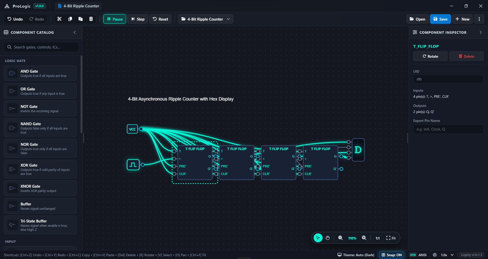
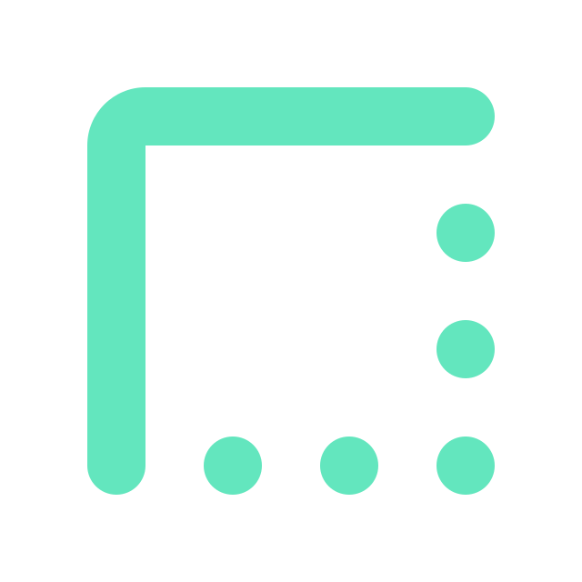

<p align="center">
  
</p>

<p align="center">
  <a href="https://github.com/ProCraftKRD/ProLogic/blob/master/LICENSE"></a>
  <a href="#test-suite--quality-assurance"></a>
  <a href="#modern--responsive-desktop-interface"></a>
  <a href="https://www.typescriptlang.org/"></a>
  <a href="https://www.electronjs.org/"></a>
  <a href="#universal-cad-interoperability"></a>
</p>
<p align="center">
  <a href="https://github.com/ProCraftKRD"></a>
  &nbsp;&nbsp;
  <a href="https://t.me/ProCraftKRD"></a>
</p>

<p align="center">
  <a href="#overview">Overview</a> •
  <a href="#workspace-showcase">Showcase</a> •
  <a href="#core-features">Features</a> •
  <a href="#system-architecture">Architecture</a> •
  <a href="#supported-formats">Formats Matrix</a> •
  <a href="#component-catalog">Components</a> •
  <a href="#keyboard-shortcuts">Shortcuts</a> •
  <a href="#getting-started">Getting Started</a> •
  <a href="#author--credits">Credits</a>
</p>

---

## Overview

**ProLogic** is an open-source, high-performance digital logic simulator and schematic CAD workstation engineered for modern circuit designers, educators, and engineers. Built with TypeScript and Electron, ProLogic combines a clean-room **3-valued simulation engine** (supporting `0`, `1`, and `Hi-Z`), an intuitive **interactive vector canvas**, comprehensive **Universal CAD Interoperability** across 7 industry schematic formats, and a full **Custom Integrated Circuit (IC) Lifecycle** designer.

Whether you are simulating basic logic gates, building complex synchronous state machines with flip-flops and clock accumulators, solving tri-state bus contentions, or migrating legacy circuits from Logicly, Logisim, Digital, or CircuitVerse, ProLogic delivers a fluid, deterministic, and publication-ready CAD environment.

---

## Workspace Showcase

<p align="center">
  
</p>

> **Live Circuit Canvas in Action**: ProLogic running in dark theme featuring active 90° orthogonal wire routes with interactive waypoints, live signal propagation (`HIGH 1` in neon cyan, `LOW 0` in slate), searchable Component Catalog, and real-time Component Inspector with pin analysis.

---

## Core Features

###  Discrete 3-Valued Simulation Engine
* **Tri-State Logic**: Native support for **HIGH** (`1`), **LOW** (`0`), and **High-Impedance** (`Hi-Z` / Undefined) across every gate, wire, and bus terminal.
* **Event-Driven Propagation**: High-throughput queue propagation handles asynchronous and synchronous circuits at a smooth 60 FPS without UI hitching.
* **Tri-State Bus Contention Resolution**: Automatically models multi-driver contention, resolving pull-ups, floating buses, and multi-source conflicts.
* **Oscillation Damping & Memory Latches**: Sub-cycle damping prevents infinite oscillation in cross-coupled feedback loops, enabling stable SR flip-flops, master-slave registers, and sequential RAM units.

###  Universal CAD Interoperability
* **Native Deflate Format (`.plgc` / `.plgclib`)**: Lossless, Zlib deflate-compressed circuit files preserving orthogonal waypoints, component rotations, and typography.
* **Logicly Full Compatibility**: Seamlessly open, edit, and save `.logicly`, `.logiclylib`, and uncompressed `.logiclyx` / `.xml` files.
* **Multi-Format Import Translators**: Native netlist parsers for **Logisim** (`.circ`), **Digital** (`.dig`), **CircuitVerse** (`.cdd`, `.cv`), and **SimcirJS** (`.simcir`).
* **OS File Associations**: Double-click any registered logic file directly from Windows Explorer to open it inside ProLogic.

###  Custom IC Lifecycle & Catalog Management
* **Subcircuit Packaging**: Encapsulate any arbitrary schematic sub-graph into a reusable black-box IC with custom input/output pinouts and names.
* **Dynamic Catalog Addition**: Packaged ICs are dynamically registered into the Component Catalog for unlimited drag-and-drop reuse.
* **Full Lifecycle Operations**: Hover delete controls, context menu unregistering, and clean metadata cleanup without document corruption.
* **Built-in Standard ICs**: Factory-configured D Flip-Flop, JK Flip-Flop, T Flip-Flop, SR Flip-Flop, and 4-Bit Hexadecimal Display.

###  Orthogonal 90° Wire Routing & Snapping
* **Dual Routing Engine**: Toggle seamlessly between natural smooth cubic Bezier splines and strict 90° orthogonal CAD wire paths.
* **Interactive Waypoints**: Click and drag any wire segment to introduce right-angle bends; double-click a waypoint to straighten and remove it.
* **Magnetic Pin Snapping**: Precision terminal snapping ensures error-free wiring even at high zoom levels.

###  High-DPI Schematic Export
* **Vector-to-Raster Pipeline**: Export publication-grade **High-DPI PNG** schematics directly from the Save As dialog or command menu.
* **Sanitized Outputs**: Automatically eliminates selection borders, rotation rings, hover handles, and canvas grid artifacts from the exported schematic.
* **Theme-Aware Color Resolution**: Exports schematics with resolved colors optimized for dark and light academic publications.

###  Modern & Responsive Desktop Interface
* **Clean Desktop Styling**: Clean, focused interface featuring subtle elevation shadows, clear typography, and rounded controls.
* **Fluid Infinite Canvas**: 60 FPS panning with focal-center stability math and normalized pinch/wheel zoom acceleration.
* **Dynamic Theme Switching**: Real-time toggling between Dark, Light, and System themes.
* **Rich Text Formatting**: In-place typographic canvas labels with customizable font size, weight, alignment, and theme-synchronized colors.

---

## System Architecture

ProLogic is structured around three decoupled, high-cohesion subsystems:

```text
┌─────────────────────────────────────────────────────────────────────────────┐
│                              PROLOGIC RUNTIME                               │
├─────────────────────────┬─────────────────────────┬─────────────────────────┤
│    Simulation Core      │   CAD Interoperability  │    Vector Workbench     │
├─────────────────────────┼─────────────────────────┼─────────────────────────┤
│ • 3-Valued Multi-Logic  │ • Native Deflate (.plgc)│ • 60 FPS Vector Canvas  │
│ • Event Propagation     │ • Logicly XML Importer  │ • 90° Orthogonal Wires  │
│ • Bus Contention Solver │ • Logisim & Digital     │ • Dynamic Inspector     │
│ • Feedback Damping      │ • CircuitVerse & Simcir │ • 2x High-DPI Exporter  │
└─────────────────────────┴─────────────────────────┴─────────────────────────┘
```

1. **Simulation Engine Core**: Pure TypeScript logic engine operating independently of DOM or Canvas APIs. It tracks internal signal states, schedules event queues, resolves tri-state buses, and propagates values across complex feedback loops.
2. **Universal CAD Interoperability Layer**: Multi-adapter translation layer capable of parsing XML, JSON, and binary deflate formats into standard ProLogic topological netlists.
3. **Vector Desktop Workbench**: Responsive Electron/Chromium UI layer featuring an interactive SVG/HTML5 canvas, reactive component inspector, customizable catalog, and high-DPI export pipelines.

---

## Supported Formats

| Format | Extension | Open | Save / Export | Storage Type | Compatibility Details |
| :--- | :---: | :---: | :---: | :---: | :--- |
| **ProLogic Circuit (Native)** | `.plgc` | **Yes** | **Yes (Default)** | Binary Deflate | Lossless native circuit format with orthogonal waypoints & ICs |
| **ProLogic IC Library** | `.plgclib` | **Yes** | **Yes** | Binary Deflate | Packaged reusable custom integrated circuit collection |
| **ProLogic Uncompressed** | `.plgcx` | **Yes** | **Yes** | XML Text | Human-readable raw XML document for Git version control |
| **ProLogic Uncompressed Lib**| `.plgclibx`| **Yes** | **Yes** | XML Text | Human-readable raw XML IC library |
| **PNG Schematic Image** | `.png` | - | **Yes** | 2x High-DPI | High-resolution publication raster schematic export |
| **Logicly Circuit** | `.logicly` | **Yes** | **Yes** | Binary Deflate | Lossless two-way interchange with Logicly v1.0–v1.3 |
| **Logicly IC Library** | `.logiclylib`| **Yes** | **Yes** | Binary Deflate | Full interchange with Logicly custom package libraries |
| **Logicly Uncompressed** | `.logiclyx` | **Yes** | **Yes** | XML Text | Standard Logicly XML schema |
| **Logisim Circuit** | `.circ` | **Yes** | - | XML Text | Auto-translates geometric wires, gates, and pin nets |
| **Digital Circuit** | `.dig` | **Yes** | - | XML Text | Auto-translates HNeemann Digital CAD circuits |
| **CircuitVerse Document** | `.cdd`, `.cv`| **Yes** | - | JSON Text | Graph solver resolves scope elements and wire connections |
| **SimcirJS Circuit** | `.simcir` | **Yes** | - | JSON Text | Auto-extracts devices and connector topologies |
| **Universal XML Circuit** | `.xml` | **Yes** | **Yes** | XML Text | Open standard interchange format |

---

## Component Catalog

ProLogic includes **22+ built-in logic primitives, controls, and instruments**:

```text
  LOGIC GATES          CONTROLS           DISPLAYS / PROBES      MEMORY & ICs
  ───────────          ────────           ─────────────────      ────────────
  [AND] Gate           Toggle Switch      Light Bulb (LED)       D Flip-Flop
  [OR]  Gate           Push Button        4-Bit Hex Display      JK Flip-Flop
  [NOT] Inverter       Clock Generator                           T Flip-Flop
  [NAND] Gate          Constant VCC (+5V)                        SR Flip-Flop
  [NOR] Gate           Constant GND (0V)                         Tri-State Bus
  [XOR] Gate                                                     Custom User ICs
  [XNOR] Gate
  [Buffer] Gate
  [Tri-State] Buffer
```

* **Typographic Labels**: Full multiline canvas annotations with real-time text synchronization, custom typography scaling (`12px` to `48px`), alignment, and color selection.
* **Component Inspector**: Real-time property inspection showing input/output pin counts, wire connections, signal levels (`HIGH 1`, `LOW 0`, `Hi-Z`), and waypoint coordinates.

---

## Keyboard Shortcuts

| Shortcut | Context | Action |
| :--- | :--- | :--- |
| `Ctrl + N` | Global | Create a new blank circuit canvas |
| `Ctrl + O` | Global | Open circuit document (`.plgc`, `.logicly`, `.circ`, etc.) |
| `Ctrl + S` | Global | Save circuit to current file (prompts `.plgc` if untitled) |
| `Ctrl + Shift + S` | Global | Save As (Universal CAD formats or High-DPI PNG) |
| `Ctrl + Z` | Canvas | Undo last circuit mutation or wiring step |
| `Ctrl + Y` | Canvas | Redo previous undone action |
| `Ctrl + C` | Selection | Copy selected components and wires to clipboard |
| `Ctrl + V` | Canvas | Paste clipboard components at cursor offset |
| `Del` / `Backspace` | Selection | Delete selected components or wires |
| `Ctrl + A` | Canvas | Select all components and wires |
| `R` | Component | Rotate selected component 90° clockwise |
| `Space` | Global | Toggle simulation Play / Pause |
| `Space + Drag` | Canvas | Pan canvas viewport freely |
| `Right-Click Drag` | Canvas | Alternate one-handed canvas viewport pan |
| `Wheel` / `Pinch` | Canvas | Smooth zoom centered on mouse cursor |
| `Shift + F` | Canvas | Zoom to fit entire circuit schematic |
| `Ctrl + 0` | Canvas | Reset zoom scale to 100% (1:1 pixel mapping) |
| `Ctrl + T` | Global | Cycle theme (Dark  Light  System) |
| `Ctrl + I` | Global | Toggle Component Properties Inspector |
| `Double-Click Component` | Canvas | Open and focus Component Properties |
| `Double-Click Wire` | Wire | Insert an interactive 90° routing waypoint |
| `Double-Click Point`| Waypoint | Remove waypoint and straighten wire segment |

---

## Getting Started

### Prerequisites
* [Node.js](https://nodejs.org/) (v18.0 or newer recommended)
* [npm](https://www.npmjs.com/) (bundled with Node.js)

### Clone & Install
```bash
git clone https://github.com/ProCraftKRD/ProLogic.git
cd ProLogic
npm install
```

### Launch Development App
```bash
npm start
```

### Test Suite & Quality Assurance
Run the comprehensive test suite verifying the 3-valued simulation core, CAD parsers, document lifecycle, undo/redo history, and schematic exporters:
```bash
npm test
```
```text
=====================================================
 ALL SUITES PASSED! Simulation Engine 100% Verified. 
 134 / 134 tests passing across 12 test modules.
=====================================================
```

### Package Production Binaries
To compile TypeScript, bundle UI assets, and build Windows production executables (NSIS Installer and Portable binary):
```bash
npm run dist
```
Distribution packages are generated in the `release/` directory:
* `release/ProLogic Setup 1.0.0.exe` — Windows NSIS Installer (Desktop & Start Menu shortcuts, file associations)
* `release/ProLogic 1.0.0.exe` — Windows Portable Standalone executable

---

## Author & Credits

ProLogic is developed with precision by **Mohammed Sabir** ([ProCraftKRD](https://github.com/ProCraftKRD)).

<p align="center">
  <a href="https://github.com/ProCraftKRD"></a>
  &nbsp;&nbsp;
  <a href="https://t.me/ProCraftKRD"></a>
</p>

---

## License

This project is licensed under the [MIT License](LICENSE).